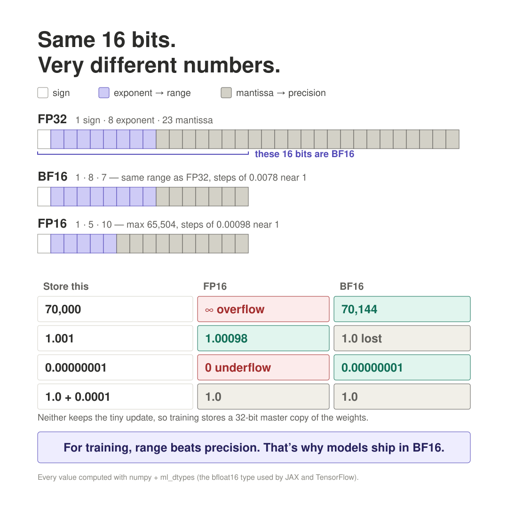
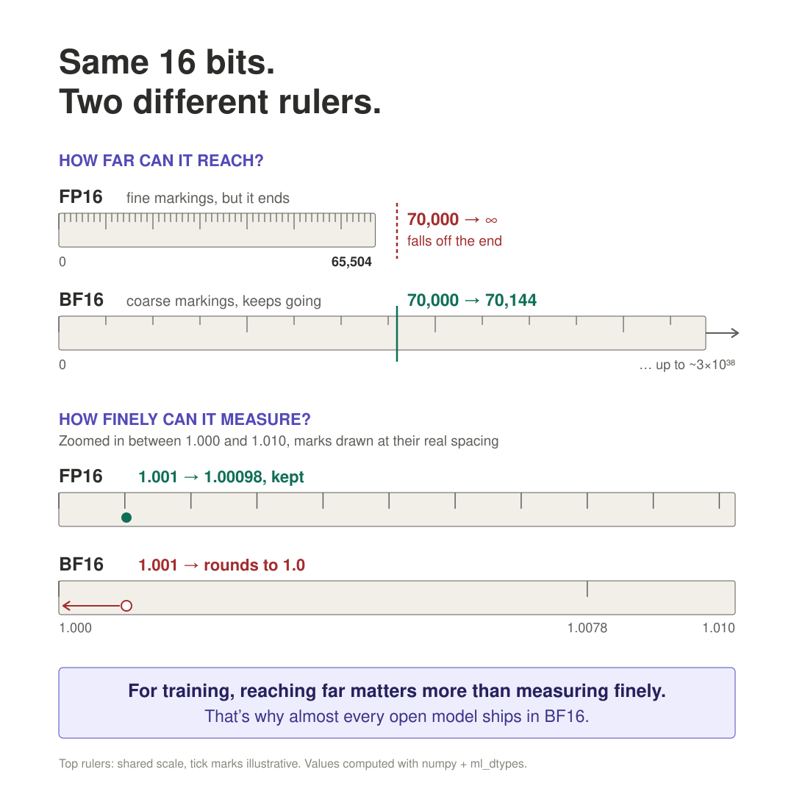

# Why 16-bit? And what's the difference between FP16 and BF16?

**Date started:** 2026-09-26
**Used in project:** background for `01-ollama-first-llm.md` (quantization: 16-bit weights -> 4-bit)

## In one sentence
A weight is stored as a **floating point number** (sign + exponent + mantissa, like binary
scientific notation); 16 bits is the standard for the **heavy math in training** because it's
the cheapest format that's still good enough there (the weight updates themselves stay in
32-bit), and BF16 vs FP16 is two different ways of
splitting those 16 bits between "how big a number can be" and "how precise it is."

---

## Floating point, in plain words

A float is basically: **sign x (a base number) x 2^(exponent)** — same idea as `6.02 x 10^23`
in scientific notation, just in binary.

- **Sign** (1 bit): positive or negative.
- **Exponent bits**: how big or small the number can get (the "zoom level").
- **Mantissa bits**: how many precise digits it keeps once zoomed in.

More exponent bits = wider **range** (very huge and very tiny numbers, without overflowing to
infinity or underflowing to zero).
More mantissa bits = finer **precision** (more exact digits, smaller gaps between representable numbers).
16 bits total has to split between these two, and that split is exactly what makes FP16 and BF16 different.

---

## FP16 vs BF16



Plain-language version (no bits, just two rulers: one short and fine, one long and coarse):



Both use 16 bits total. They split them differently:

```
FP16   (IEEE half precision)
  [S] [ 5 exponent bits ] [   10 mantissa bits   ]
       narrower range         more precision

BF16   ("brain float", from Google Brain)
  [S] [   8 exponent bits   ] [ 7 mantissa bits ]
       same range as FP32          less precision
```

| | FP16 | BF16 | FP32 (for comparison) |
|---|---|---|---|
| Exponent bits | 5 | 8 | 8 |
| Mantissa bits | 10 | 7 | 23 |
| Range | narrow — overflows around ±65,504 | same huge range as FP32 (~1e-38 to ~3e38) | huge |
| Precision | higher (more exact digits) | lower (coarser steps) | highest |

### Worked examples with real numbers

**Example 1 — a big number: BF16 survives, FP16 breaks**

Say a value during training reaches **70,000** (activations/gradients can spike this high).

- **FP16** tops out at exactly **65,504**. 70,000 is bigger, so FP16 can't represent it —
  it **overflows to infinity**. Once one value is `inf`, it multiplies through the network
  into `NaN` ("not a number") and corrupts training.
- **BF16** has FP32's exponent range (up to ~3.4 x 10^38), so 70,000 is nowhere near the ceiling.
  It gets rounded to the closest value its 7-bit mantissa can store:

```
70,000 stored in BF16  ->  70,144   (off by ~0.2%, but still a usable number)
70,000 stored in FP16  ->  inf      (broken — training stops working)
```

BF16 loses a little precision but keeps training alive. FP16 keeps more precision but dies here.

**Example 2 — two close numbers: FP16 tells them apart, BF16 can't**

Take **1.0** and **1.001**. Near the value 1, each format can only represent points spaced a
fixed distance apart (the "resolution"), fixed by how many mantissa bits it has:

| Format | Mantissa bits | Resolution near 1.0 | Can it tell 1.0 and 1.001 apart? |
|---|---|---|---|
| FP16 | 10 | 0.000977 | **Yes** — 1.001 rounds to 1.0009766, a distinct value |
| BF16 | 7 | 0.0078125 | **No** — both round to the same stored value, 1.0 |

BF16's steps near 1 are `1.0, 1.0078125, 1.015625, ...`. Since 1.001 is closer to 1.0 than to
the next step, it rounds down and **collapses into 1.0** — the distinction is lost. FP16, with
finer steps, keeps them separate.

**Why this settles in BF16's favor for training**

The overflow in Example 1 is fatal — it produces garbage and the model stops learning. The
precision loss in Example 2 is just noise — a small rounding error training already shrugs off,
similar to how it tolerates randomness from batch order or dropout. Given that trade,
**avoiding overflow matters more than keeping fine precision**, which is why BF16 became the
default over FP16 for training LLMs.

### A couple more details

- Training with FP16 anyway (some setups still do) needs a workaround called **"loss scaling"**.
  It fixes the *other* end of the range: **underflow**. FP16 can't store anything smaller than
  ~6e-8, so a tiny gradient like 0.00000001 silently becomes **0** and that weight stops learning.
  Loss scaling multiplies the loss (and so every gradient) by a big factor, e.g. 1024, before the
  backward pass, then divides it back out before updating the weights. BF16 reaches down to
  ~1e-38, so it keeps 0.00000001 as-is and mostly doesn't need this.
- That's why **BF16 is the default for training and storing modern LLMs** (Qwen, Llama, Gemma, ...),
  and FP16 is less common today outside of some inference-only setups.
- Converting BF16 <-> FP32 is also cheap: just truncate/pad the mantissa, since the exponent
  layout already matches. That made it easy for hardware and software to adopt.

---

## Why 16 bits at all, and not 32 or 8?

Training repeatedly nudges every weight by a tiny amount, e.g. 0.0001. The catch: **16-bit
alone can't do that.**

```
1.0 + 0.0001  in FP16  ->  1.0      (the step size near 1 is 0.000977, so 0.0001 rounds away)
1.0 + 0.0001  in BF16  ->  1.0      (step near 1 is 0.0078, even coarser)
1.0 + 0.0001  in FP32  ->  1.0001   (step near 1 is 0.00000012)
```

So real training is **mixed precision**, splitting the work by what each part needs:
- **16-bit (BF16) for the heavy math**: the huge matrix multiplications in the forward and
  backward pass. That's most of the compute, half the memory of 32-bit, and modern GPUs have
  hardware built specifically to do 16-bit math fast. Small rounding errors here are just noise.
- **32-bit for the weight updates**: a **"master copy"** of the weights (and the optimizer's
  running averages) is kept in FP32, so `weight + tiny update` actually changes the weight.
  Each step, the 16-bit copy used for the math is refreshed from it.
- **8-bit**: some recent frontier models even do part of the heavy math in **FP8**, with careful
  per-block scaling, still keeping higher-precision master weights. Far fiddlier, so BF16
  remains the default.

Once training is finished, the weights are **frozen** — no more tiny accumulating updates,
just repeated multiplication with fixed numbers. That's a much easier job, which is why it
tolerates being rounded down further (**quantization**) to 8-bit or 4-bit for local/inference
use, without the model "forgetting" much. See `01-ollama-first-llm.md` for how that gets me
from an ~8 GB file down to the ~3 GB one I'm running.

---

## Does 4-bit quantization still use floating point?

Mostly **no** — it switches to a different scheme: **integers + a shared scale factor**,
not floats with an exponent and mantissa.

**Why floats stop making sense at 4 bits.** A float needs bits for sign, exponent, *and*
mantissa. With only 4 bits total there's barely anything left for precision after carving
out a sign and exponent. An integer uses all 4 bits just to count, giving 16 possible values
(0-15) instead, and a separate (float) scale factor does the job the exponent used to do.

**The formula:**
```
real_value ≈ stored_int × scale + min
```
Weights are grouped into small **blocks** (e.g. 32 weights), and each block stores its own
`scale` and `min`, computed from that block's own range. The integers 0–15 can't be negative,
so `min` shifts them to where the block's values actually are.

**Worked example.** Say a block of BF16 weights ranges from **-2.0 to +2.0**:
1. `min = -2.0` (the smallest value), `scale = (2.0 - (-2.0)) / 15 ≈ 0.267` (range / 15 steps).
2. To store the weight **1.3**: `(1.3 - (-2.0)) / 0.267 ≈ 12.4` → round to the integer **12**.
3. To read it back: `12 × 0.267 + (-2.0) = 1.2`. Close to 1.3, but not exact. That gap is the
   cost of quantization; it's at most half a step (~0.13 here).
4. The block's lowest weight, -2.0, is stored as `0`, and the highest, 2.0, as `15`. The full
   range fits.

(Simpler schemes like **Q4_0** skip `min` and use signed integers −8…7 with only a scale. Same
idea, one number less per block.)

Each block of 32 now needs 32 × 4-bit integers (16 bytes) + a scale and min (a few bytes),
instead of 32 × 16-bit floats (64 bytes). Most of the ~8 GB → ~3 GB shrink comes from this.

**What Ollama actually uses.** The models I pull are in **GGUF** format with a scheme like
**Q4_K_M**, which is this exact scale + min idea, but smarter:
- **Two-level blocks:** 256-weight "super-blocks" split into 8 sub-blocks of 32. Each sub-block
  gets its own scale and min, and those are themselves stored as small 6-bit numbers (scaled
  once per super-block), so the overhead stays tiny.
- **The "M" (medium) mix:** a few of the most sensitive weight tensors are kept at higher
  precision (6-bit) instead of 4-bit.

That's why quality holds up better than naive 4-bit rounding would suggest.

**The exception.** A few specialized schemes (**NF4**, used in QLoRA fine-tuning, and **FP4**)
do keep a tiny floating-point-like structure even at 4 bits. But GGUF/Q4_K_M (what Ollama uses)
is integer + scale, not this.

## Gotchas / mistakes I made
Found while fact-checking this note for a post (2026-10-18), every number re-run with
`uv run --with numpy --with ml_dtypes` (ml_dtypes = the bfloat16 type JAX/TensorFlow use):
- I first wrote that 16-bit is "precise enough for the tiny updates to register". **Wrong:**
  `1.0 + 0.0001` is `1.0` in both FP16 and BF16. That's why training keeps FP32 master weights.
- I first wrote that loss scaling dodges FP16's **overflow**. **Backwards:** it fixes
  **underflow** (tiny gradients like 1e-8 becoming 0 in FP16).
- My first 4-bit example used `int × scale` with integers 0–15 for a -2…+2 block, which can't
  store any negative weight. Needs a `min` offset (or signed integers).
- Verified as correct: FP16 max 65,504 (65,520 → inf); 70,000 → FP16 inf, BF16 70,144;
  1.001 → FP16 1.0009765625, BF16 1.0; BF16 = top 16 bits of FP32 (pi 0x40490fdb → 0x4049).

## Questions still open
-

## Links
- https://en.wikipedia.org/wiki/Bfloat16_floating-point_format
- https://en.wikipedia.org/wiki/Half-precision_floating-point_format
- https://github.com/ggml-org/llama.cpp/blob/master/gguf-py/gguf/quants.py (GGUF quant formats used by Ollama)
