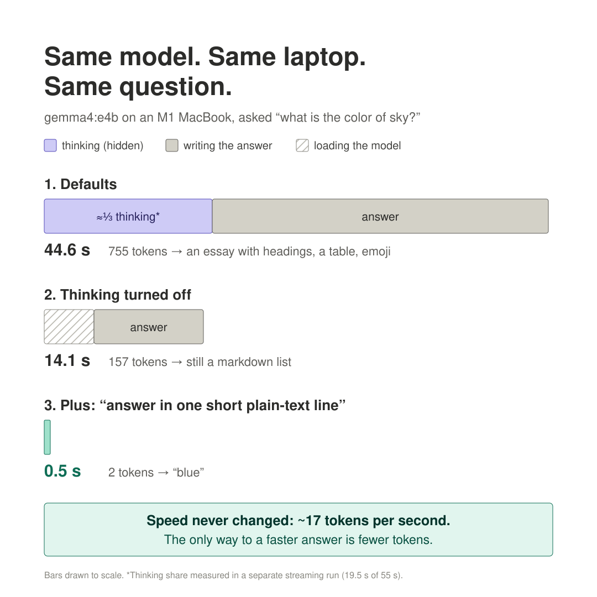

# Ollama's HTTP API: `/api/chat`, streaming, thinking, timing

**Date started:** 2026-10-11
**Used in project:** Phase 2 step 1; the future `ai/` service calls this to summarize events

## In one sentence
Ollama is a local server on `localhost:11434`. I `POST` a JSON list of messages to `/api/chat`
and get the model's answer back as JSON, along with timing stats that show exactly where the
time went.

## Why I needed it
Walkie's AI service will call Ollama from code, not via `ollama run`. Before writing that
code I wanted to see the raw requests and responses with `curl`, and find out what makes a
call slow or fast.

## How it works

### Local vs cloud, and the "base URLs" table
The docs' intro page mixes up three ideas:
- **Ollama runs open models itself.** It never forwards calls to OpenAI or Anthropic.
  - **Local:** the model runs on my M1 at `http://localhost:11434`. No API key, free, offline.
    This is what Walkie uses.
  - **Ollama Cloud:** Ollama-the-company runs models from *their* catalog (e.g. big ones like
    `gemma4:31b` that don't fit in 16 GB) on their GPUs. Needs an API key. I'm renting their
    hardware, not hosting my own model there.
- **Base URL** is just the address prefix: base `http://localhost:11434/api` + `/chat`.
- **The same server speaks three request formats:** its own (`/api/...`, the one I use),
  OpenAI's (`/v1/...`) and Anthropic's. So a tool built for OpenAI can use my local model by
  changing **one setting** (its base URL), not its code. Only those two because most tools
  are written against them, and OpenAI's format is the de facto standard other providers copy.
- Proof it's one server: `curl localhost:11434/api/tags` and `curl localhost:11434/v1/models`
  both list the same `gemma4:e4b`.

### The request
```bash
curl localhost:11434/api/chat -d '{
  "model": "gemma4:e4b",
  "think": false,
  "stream": false,
  "messages": [
    {"role": "system", "content": "answer in one short plain-text line with no markdown"},
    {"role": "user",   "content": "what is the color of sky?"}
  ]
}'
```
- `-d` makes curl send a **POST**. Without it curl sends GET → `405 method not allowed`.
- `system` message = instructions for *how* to answer; `user` message = the actual question.

### The response fields
| Field | Meaning |
|---|---|
| `message.content` | The **visible answer**. When streaming, each chunk carries one piece; join them. |
| `message.thinking` | The model's **reasoning, written out as text**. These *are* generated output tokens; they just go here instead of `content` and aren't meant for the user. |
| `done` | `true` only on the **last** chunk: the end of the whole response (not the end of thinking). |
| `eval_count` | Tokens the model **generated**, *including thinking tokens*. |
| `eval_duration` | Time spent generating them. |
| `prompt_eval_count` | Tokens the model **read**: system prompt + my message + hidden formatting tokens Ollama wraps around each message (so a 6-word question = 16 tokens). |
| `prompt_eval_duration` | Time spent reading them. |
| `prompt_eval_cached_count` | Prompt tokens reused from the previous call instead of read again (prompt caching). |
| `load_duration` | Time to load the model into memory. ~0 if it's already loaded. |
| `total_duration` | Everything, end to end. |

**All durations are in nanoseconds.** tok/s = `eval_count` ÷ (`eval_duration` ÷ 10⁹).

### Streaming (the default)
- One JSON line per token or so. In my run `created_at` was ~60 ms apart → ~16–17 tok/s,
  visible directly in the timestamps.
- Order: **`thinking` chunks (empty `content`) → `content` chunks → final chunk with
  `done: true`** carrying all the stats. The switch from thinking to answering is the first
  chunk where `content` isn't empty.
- If code only reads `content`, the stream looks silent during the whole thinking phase.
- `"stream": false` waits and returns one JSON object. Better for Walkie's summaries: my
  backend wants the final string, no human is watching it type.

### Thinking
`think: false` makes the model skip writing its reasoning and answer directly. **Thinking is
output tokens spent on reasoning: I pay for them in time even though they're not the answer.**
A one-line summary doesn't need reasoning.

### `keep_alive`
After each request Ollama keeps the model in memory for a while (**default 5 minutes**). The
timer **restarts on every request**. After that the model is unloaded, and the next call pays
`load_duration` again (~4.4–6.5 s for gemma4:e4b). Can be set per request, e.g. `"keep_alive": "30m"`.

## Minimal example
Same model, same question, same M1. Each change cuts tokens generated:



| | `eval_count` | `total_duration` | Answer |
|---|---|---|---|
| Defaults (thinking on) | 755 | 44.6 s | markdown essay with headings, table, emoji |
| `"think": false` | 157 | 14.1 s (4.4 s of it was loading) | markdown bullet list |
| `think: false` + system prompt | **2** | **0.51 s** | `blue` |

With thinking on (a streaming run): ~19.5 s thinking before the first visible word, then
~35.6 s answering. About a third of the time was reasoning I never saw.

**Takeaway:** speed (~17 tok/s) is fixed by the hardware and model. The only way to get fast
answers is to **generate fewer tokens**: turn thinking off and ask for short output. Once
output is tiny, *reading* the prompt becomes the main cost (0.42 of the 0.51 s), so input
length matters next.

## Gotchas / mistakes I made
- `localhost:1143` / `4` in the terminal was just line-wrapping, not a typo.
- **JSON doesn't allow trailing commas** (`[...],\n}` → `invalid character '}' looking for
  beginning of object key string`). Python and JS allow them, so it's an easy slip. The error
  names the character it didn't expect; look at what comes right before it.
- A trailing comma after the header (`-H "Content-Type: application/json",`) becomes part of
  the header value. Ollama ignored it, but it's wrong.
- Forgetting the `\` at a line end ends the command early. With no `-d`, curl sent a GET → 405.
- Tip: put the body in a file and use `curl ... -d @body.json`; validate it with
  `python3 -m json.tool body.json`.
- Same question twice gives different wording: the model samples words with some randomness
  (`temperature` in `options`). Probably want it low for summaries.
- A system prompt can be obeyed *too* well: "blue" is short but not informative. Walkie's
  summaries need to be short **and** useful (step 3).

## Questions still open
- What `temperature` gives the most consistent summaries?
- Set `keep_alive` longer for Walkie, or accept a ~4–5 s first summary after quiet spells?
- How much of a long event (e.g. a big tool output) to send, given that input length now dominates?
- Does `qwen3.5:4b` follow the one-line instruction better than `gemma4:e4b`? (Need to pull it again.)

## Links
- https://docs.ollama.com/api (intro: local vs cloud, base URLs)
- Chat endpoint reference: in the API Reference sidebar under "Chat"
